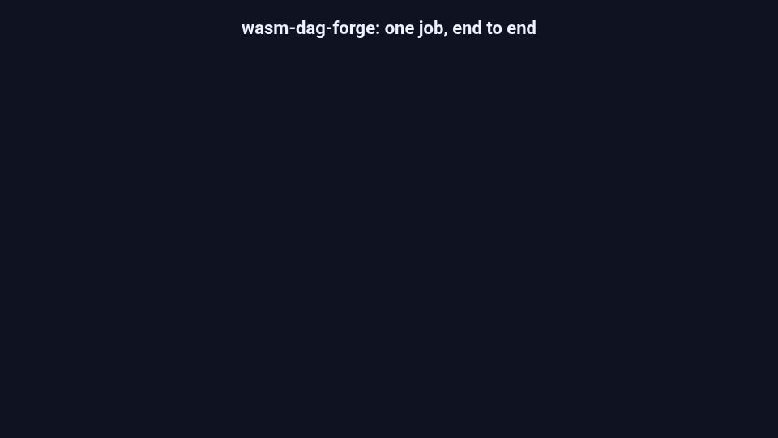

# Weft

Durable batch simulation, woven at scale.

  
  
  
  

Weft is a proof of concept that runs large scale digital validation as durable batch jobs on Temporal: a job compiles a testbench, runs it across many seeds and configurations, and aggregates the results, scaling to millions of jobs and to jobs that run for weeks on a fixed-size local Kubernetes cluster.
Guest workloads run as WebAssembly components.

## Worked example

This animation follows one job from submission to completion.

## Getting started

See [docs/dev-setup.md](docs/dev-setup.md) for the host and the dev shell, and [docs/runbooks](docs/runbooks/README.md) to bring the system up, prove it, triage a failure and tear it down.

## License

Licensed under the [Apache License 2.0](LICENSE).
