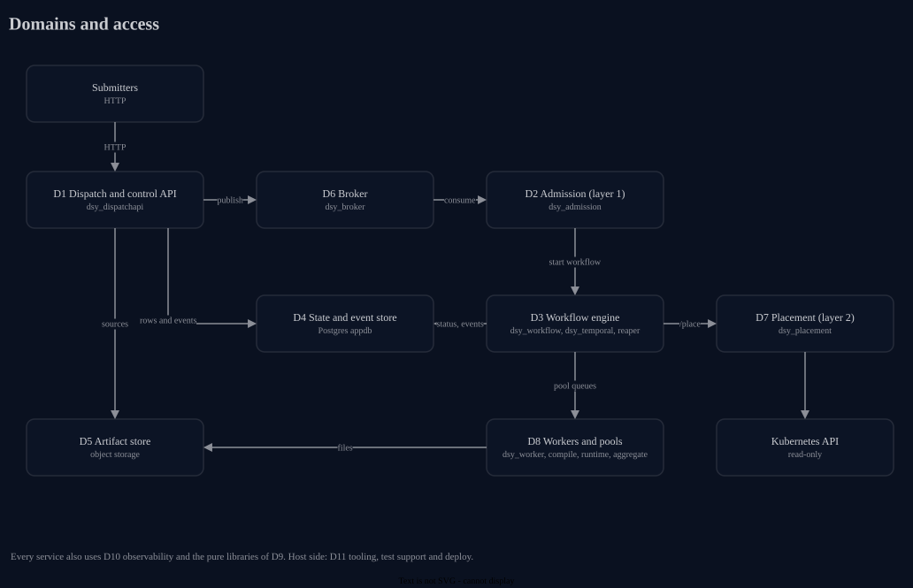

# Domains and access

The domain map of the platform, how the domains reach each other, and the seams that remain.
It is derived from the workspace dependency graph, the imports of the five dependency kinds in `packages/*/src` and the call sites named in the table.
The map is by ownership of data and of deployables, so a package sits in exactly one domain.
The design is in [the platform seams epic](../delivery/epics/19-platform-seams.md).

Every service also uses D10 observability and the pure libraries of D9.
D11 is the host side: tooling, test support and deploy.

## The domain map

| # | Domain | Packages (src) | Deployables | Owns (data) | In | Out |
| --- | --- | --- | --- | --- | --- | --- |
| D1 | Dispatch and control API | `dsy_dispatchapi` | `dispatch-api` (`deploy/dispatchapi`) | rows of `accepted_job` as writer on accept, the intake publish, source uploads | HTTP from submitters (`service/routes.py`), operators | Postgres as 4 logins (`dispatch`, `control`, `artifacts`, `reader`), RabbitMQ publish (`publish.py:69`), object store as `submit`, Temporal signal, query and describe (`gateway.py:73-88`) |
| D2 | Admission (layer 1) | `dsy_admission` | `admission` (`deploy/admission`) | the `accepted` to `admitted` claim, workflow starts | RabbitMQ intake queues (`intake.py:24,375-381`) | Postgres as login `admission`, Temporal `start_workflow` (`start.py:64`) and queries (`resume.py:180`, `scan.py:186`) |
| D3 | Workflow engine | `dsy_workflow`, `dsy_artifactreaper` (hosted in the same process), `dsy_temporal` | `workflow-worker` (`deploy/workflow`) | `JobWorkflow`, the control activities, status moves and events through `emit` (`activities/emit.py`), the naming and pool contract loaders (`contract.py`) | Temporal workflow and activity tasks, admission's start | Postgres as 3 logins (`workflow`, `artifacts`, `reaper`), object store (`cache`, `commit`, `index`, `plan` activities), placement over HTTP (`placement.py:127,137`), pool task queues |
| D4 | State and event store | `dsy_jobstate`, `dsy_eventstore`, `dsy_artifactindex`, `dsy_stateops`, `dsy_migrate` | none of its own (`appdb`, `deploy/appdb`) | the Postgres schema: tables `accepted_job`, `event`, the artifact index, the 7 group roles of `R__roles.sql` | every writer, as a library on a `psycopg` connection it is handed | Postgres only |
| D5 | Artifact store | `dsy_artifactclient`, `dsy_storecheck` | none (`deploy/objectstore`) | the buckets and their layout, staging, commit, cache and checkpoint rules | D1 (sources), D3, D8, the reaper | the S3 API through `dsy_storecheck.s3` |
| D6 | Broker | `dsy_broker` | none (`deploy/rabbitmq`) | intake queues, dead letters, tenancy profile loader | D1 publish | AMQP 1.0, `proton` imported only in `broker/client.py` |
| D7 | Placement (layer 2) | `dsy_placement` | `placement` (`deploy/placement`) | pool choice, memory class and timeouts, from `pools.yaml` | HTTP `/place` from D3 (`/pools` has no workflow caller) | the Kubernetes API read-only (`kube.py:42-46`) |
| D8 | Workers and pools | `dsy_worker`, `dsy_compile`, `dsy_runtime`, `dsy_aggregate`, `dsy_kernel`, `dsy_workloads` | `compile`, `simulate`, `aggregate` pool workers (`deploy/workers`) | task execution: `run_task`, the guest sandbox | Temporal activity tasks on pool queues | object store through `ArtifactClient`, a child process (wasmtime) |
| D9 | Job model, events and keys | `dsy_jobdoc`, `dsy_jobcheck`, `dsy_plan`, `dsy_jobpatch`, `dsy_jobexamples`, `dsy_jobtools`, `dsy_events`, `dsy_keys`, `dsy_compat`, `dsy_stages` | none | the job document, plan, events, key formulas | every domain | none, pure libraries |
| D10 | Observability | `dsy_obs` | the stack (`deploy/obs/*`) and the `state-inputs` exporter (`obs/inputs/`) | setup of logs, traces, profiles, the metrics runtime, the read client of the stack | every service | OTLP, Pyroscope, a Postgres reader for the exporter |
| D11 | Tooling, test support and deploy | `dsy_itest`, `dsy_clusterkit`, `dsy_acceptance`, test modules inside src packages (`dsy_workflow.testing`, `dsy_workflow.harness`, `dsy_migrate.fixtures`, `dsy_storecheck.fixtures`, `dsy_broker.testing`, `dsy_obs.testing`) | none | `scripts/`, `just/`, `deploy/*`, the host-side cluster drivers | host | the cluster, containers |

## Reading the map

- `naming()` and `pools()` are the Temporal naming contract loaders and live in D3 (`dsy_workflow/contract.py`).
  A new library therefore takes the namespace as an argument and does not call `naming()` itself, or it would depend on D3 and close a cycle.
- The reaper (`dsy_artifactreaper`) is deployed inside the workflow process and has no deploy unit of its own.
  It is the one existing module that attaches to the workflow host.

## Seams that remain

Adding a workflow module, a new job template or a new workload needs no edit of a core package.
These additions do touch a core contract, so each opens a contract change on purpose:

- a database table, because it edits the roles file `R__roles.sql`
- an event type, because it edits the event catalogue in `contracts/events`
- a metric, because it edits `contracts/instrumentation/metrics.yaml`

A module that fails on import, in construction or on a repeated name is skipped and logged at error level, and the host starts without it.
The three built-in workers stay hand-built in `serve` and keep their fail-fast behaviour, because moving them into modules is not needed for the seam.

A new task type (kind C) has no seam.
This is the pinned touch list of what it edits today:

| Kind | Core paths a new one must edit today | Count |
| --- | --- | --- |
| A job template | none | 0 |
| B workload | none (`dsy_workloads` is a bundle; a new workload needs a case in `main.py`, which is the library of workloads and not the core) | 0 |
| C task type | the literal `("compile", "simulate", "aggregate")` and per-type branches in `jobdoc/loader.py:18,179,208`, `jobdoc/profile.py:13`, `jobdoc/registry.py:15-25`, `jobdoc/models.py:284-296`, `jobdoc/plan_models.py:42-55`, `jobcheck/{limits,references,resolver,resources}.py`, `jobpatch/check.py:16-18`, `plan/{binding,stats}.py`, `placement/metrics.py:12`, `dispatchapi/submit.py:392-394`, `packages/events/src/dsy_events/models.py:213`, `packages/workflow/src/dsy_workflow/models.py:54`, `packages/workflow/src/dsy_workflow/contract.py:38-39`, plus `contracts/job/registry.json`, `contracts/temporal/pools.yaml`, a pool Deployment | 17 source files and 3 contract or deploy files |
| D workflow module | `dsy_workflow.service.serve` (hand-written worker list) | 1 file, and no core edit after the seam exists |

The task type set is closed by the job contract, the plan models and the placement table, so opening it is a contract change for a later epic.
